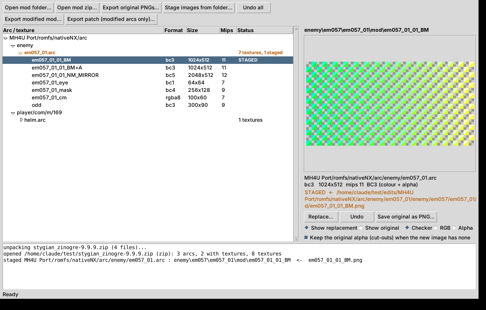

# MHGU Mod Texture Editor

Replace the textures inside **Monster Hunter Generations Ultimate (Switch)** mods without hex editing, DDS
tools or digging through folders. Open a mod (a release zip or a mod folder), browse every `.arc` and its
textures, drop your own images on them, and export either the whole modified mod or a small patch that holds
only the arcs you changed.

Made for the [MH4U Port](https://github.com/Scrimas/MH4U-port-to-MHGU) mod (Stygian Zinogre, Gogmazios,
Dalamadur, …), and works with any MHGU `.arc`. Windows and Linux (Arch first; other distributions work too).



## Features

- **Opens whole mods**: a release zip such as `stygian_zinogre-1.0.3.zip` or a mod folder. A zip is unpacked
  to a temporary folder; the original is never changed.
- **Browse** every arc that holds textures, in its folders, with format, size and mip count per texture.
  Preview with checker / RGB / alpha views.
- **Drag and drop** an image (PNG, JPG, TGA, BMP, TIFF, WebP) onto the preview or a texture's row to
  **stage** a replacement. *Undo* under the preview, *Show original* to compare, *Undo all*.
- **Exports**, as a folder or a zip, to a place you choose:
  - the **whole modified mod** (same files, same order as the original zip, modified arcs repacked);
  - a **patch** with only the modified arcs, at their full paths
    (`MH4U Port/romfs/nativeNX/arc/enemy/em057_01.arc`), ready to copy over an installed mod.
- **Bulk work**: export every original texture as PNG templates, then stage a whole folder of edited
  images at once (matched by that layout or by unique texture name).
- **Correct encoding**: each image is encoded in the format of the texture it replaces (BC1 / BC3 / BC4 /
  BC5 / RGBA8), with the mip chain, the Switch (Tegra X1 block-linear) memory layout and the original header.
  Keeps the original alpha (cut-outs) when your image has none, allows other sizes, warns on aspect changes.
  Every rebuilt arc is read back and verified before it is written.
- **Command line** for scripts: the same mod flow plus single-arc tools (list, export, replace, unpack /
  pack, loose `.tex` ⇄ `.png`).

## Install

### Windows

1. Install [Python 3.9+](https://www.python.org/downloads/) (tick **Add python.exe to PATH**).
2. Download this repository (green **Code** button → **Download ZIP**, or a release zip) and unpack it.
3. Double-click **`Install requirements.bat`** once.
4. Double-click **`MHGU Texture Tool.bat`**, or drop a mod zip or folder onto it.

### Linux (Arch)

```sh
git clone <this repository> && cd mhgu-mod-texture-editor
./install.sh
```
The installer offers `sudo pacman -S --needed python tk python-numpy python-pillow zenity` (kdialog on
KDE) for what is missing, installs the `mhgu-texture-tool` command and an app-menu entry, and sets up drag
and drop in a private Python environment. Details, Wayland / HiDPI notes and other distributions:
[docs/linux.md](docs/linux.md).

## Using it

1. **Open a mod**: *Open mod zip…* / *Open mod folder…*, or drop it on the window.
2. **Find a texture**: expand an arc in the tree and click a texture to preview it.
3. **Replace**: drop an image on the preview (or the row), or use *Replace…*. The row turns orange
   (**staged**); notes such as "kept the original alpha" appear under the preview. *Undo* / Ctrl+Z reverts.
4. **Export**: *Export modified mod…* or *Export patch (modified arcs only)…*, choose **Folder** or
   **Zip file** and where to save. The form shows what will be written before you confirm.

Tips:
- *Export original PNGs…* first, and paint over those: the UV layout must match the model.
- Recolouring a body? Also look at its `…_BM+A` texture (the shine), so highlights still fit.
- Install a patch by extracting it into the folder that contains `MH4U Port`, e.g. Ryujinx's
  `mods/contents/0100770008dd8000/`.

### Stygian Zinogre's textures

`MH4U Port/romfs/nativeNX/arc/enemy/em057_01.arc`, folder `enemy\em057\em057_01\mod\`:

| name | format | what it is |
|---|---|---|
| `em057_01_NN_BM` | BC3 | colour; **alpha = cut-out** (fur edges) |
| `em057_01_NN_BM+A` | BC3 | specular mask (grey; bright = shiny) |
| `em057_01_NN_NM_*` | BC5 | normal map (only red + green are stored) |

Armour and weapon arcs (`…/arc/player/`, `…/arc/weapon/`) have their own textures.

## Command line

```sh
python mhgu_tex_tool.py mod stygian_zinogre-1.0.3.zip --list
python mhgu_tex_tool.py mod stygian_zinogre-1.0.3.zip --export-pngs originals
python mhgu_tex_tool.py mod stygian_zinogre-1.0.3.zip --images my_edits --out patch.zip --patch
python mhgu_tex_tool.py mod stygian_zinogre-1.0.3.zip --images my_edits --out modded_folder
python mhgu_tex_tool.py -h          # every command
```
On Linux after `install.sh`, use `mhgu-texture-tool` instead of `python mhgu_tex_tool.py`.

## Repository layout

| path | what |
|---|---|
| `mhgu_tex_tool.py` | the whole tool (GUI + command line), one file, shared by every platform |
| `MHGU Texture Tool.bat`, `Install requirements.bat` | Windows launcher and setup |
| `mhgu-texture-tool`, `install.sh` | Linux launcher (first-run environment setup) and installer |
| `requirements.txt` | Python packages: numpy, Pillow, tkinterdnd2 |
| `icon.png` | app / window icon |
| `tests/` | tests on generated data (no game files needed): `python -m unittest discover -s tests -v` |
| `scripts/make_release.py` | builds the Windows zip and the Linux tarball into `dist/` for a GitHub release |
| `docs/` | Linux notes, file-format notes |

## Development

```sh
pip install -r requirements.txt
python -m unittest discover -s tests -v
python scripts/make_release.py          # dist/…-windows.zip, dist/…-linux.tar.gz
```
The tests run on Linux and Windows through GitHub Actions (`.github/workflows/tests.yml`). The GUI itself
needs a display and is not part of them. Formats are documented in [docs/formats.md](docs/formats.md).

## Credits and license

The ARC container and TEX swizzle / BCn logic follow `tools/arcpack.py` and `tools/tex.py` of
[Scrimas/MH4U-port-to-MHGU](https://github.com/Scrimas/MH4U-port-to-MHGU), whose texture round trip was
verified byte for byte over every MHGU monster arc. That project is GPL-3.0-or-later, and so is this one:
see [LICENSE](LICENSE).

No game data is included or needed in this repository. Monster Hunter is a trademark of Capcom; this project
is not affiliated with Capcom or with the MH4U Port project.
